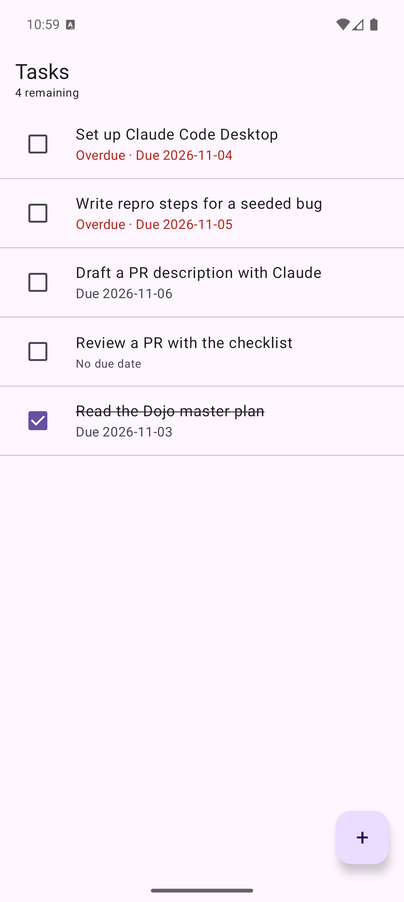

# Day 2 exercise: ticket analysis, reproduce #3, conflict #1

Phase: [phase-03-day-02-ticket-analysis-reproduce.md](../261031-0357-dojo-w1-shared-fundamentals/phase-03-day-02-ticket-analysis-reproduce.md)

**Outcome.**
- Analyzed 5 tickets (#3, #4, #5, #7, #9).
- Reproduced #3 from a clean clone on the emulator.
- Ran 3 hypotheses. Only H1 (the inclusive date boundary) holds.
- Wrote a failing unit test on branch `day-2-issue-3-overdue-repro`.
- Resolved conflict #1 on branch `day-2-conflict-1-practice`.

Sections 5 and 6 are left for me to fill in: the partner comparison, the reporter role-play and Claude 101 lessons 7–13.

---

## 1. Ticket analyses (3 sentences each)

Format: **Asked**, then **Ambiguous**, then **First step**. Claude produced these cold from the issue text. I spot-checked them against the code only to make the first steps concrete.

### #3 Overdue label looks wrong (bug)
- **Asked:** a task shows a red "Overdue" label while the user believes its due date has not passed.
- **Ambiguous:** we don't know the task's due date, the device date or time zone, when "this morning" was, or whether "not late yet" means the task is due today or later.
- **First step:** create a task due today and one due tomorrow, then check which ones get the label. This is the cheapest test of a boundary bug.

**Clarifying questions for the reporter**
1. What due date did that task have, and what was the date on your phone when you saw it?
2. Was it due *today*, or on a later day?
3. Did the label go away by itself the next day, or did it stay?
4. Have you changed your phone's time zone recently, or were you travelling?
5. Is it one task, or every task due on a certain day?

### #4 Editing a task makes a copy (bug)
- **Asked:** saving an edit creates a new task instead of updating the existing one.
- **Ambiguous:** we don't know whether this happens for every field or only the title, whether it happens on every edit, or which screen the edit started from (detail screen or list).
- **First step:** open a task, change its title, save, and count the rows. Then read `TasksViewModel.saveForm` and `InMemoryTaskRepository.save` to see how the task id is passed through.

**Clarifying questions**
1. How did you start editing: from the task's detail screen, or some other way?
2. Does it also happen if you change only the notes or the due date?
3. Does it happen every time, or only sometimes?
4. Did the copy have the old title and the original keep the new one, or the other way round?

### #5 Blank task in my list (bug)
- **Asked:** a row with no visible title exists, even though saving without a title should be blocked.
- **Ambiguous:** "no title" may mean an empty title or one made of spaces, and the user isn't sure they created it.
- **First step:** in the add form, try to save a title of only spaces, then compare with `TaskRules.validateTitle`.

**Clarifying questions**
1. When you tapped Save, was the title box completely empty, or could it have had a space in it?
2. Did you see any error message under the title box?
3. Can you make it happen again? If so, what exactly did you type?
4. Does the blank row have notes or a due date?

### #7 App forgets my tasks (filed as enhancement, reads like a bug)
- **Asked:** tasks should survive closing and reopening the app.
- **Ambiguous:** storage is in memory by design (see README), so this is a feature request rather than a defect. We also don't know whether "reopen" means swiping the app away, rebooting, or the OS killing it in the background.
- **First step:** with the product owner, decide whether persistence (Room or DataStore) is in scope and what "remember" must cover (tasks, done state, order). Then write acceptance criteria.

**Clarifying questions**
1. When you say "reopen", do you swipe the app away from recents, restart your phone, or just come back to it later?
2. Should done tasks be remembered too?
3. Should the sample tasks appear only the first time, or never?
4. Is it OK if tasks are kept only on this phone (no sync)?

### #9 Make the list less confusing (vague enhancement)
- **Asked:** the list order should be easier to understand.
- **Ambiguous:** "confusing" isn't defined. It could be the sort rule itself (open tasks first, then by due date, undated last, done at the bottom), the lack of section headers, or a related bug such as #3.
- **First step:** ask the reporter for one screenshot and say what order they expected. Then write down the current rule (`TaskRules.sortForList`) and propose headers or a sort option.

**Clarifying questions**
1. Can you send a screenshot and point to the task that seems to be in the wrong place?
2. In what order would you expect your tasks to be?
3. Would headers like "Overdue / Today / Later / Done" help?
4. Did the wrong "Overdue" labels (#3) add to the confusion?

### Gaps Claude flagged across the backlog
- None of the reports state the app version, Android version or date and time zone. For date bugs, those matter most.
- #3 and #9 may be linked: a wrong overdue label makes the order look wrong too.
- #7 and #8 are filed as enhancements, but a user would read #7 as data loss. I'll set expectations in the reply.

---

## 2. Reproduce #3 from a clean clone

**Setup** (fresh `git clone` of `main` @ `e113532` into a scratch dir)
```bash
git clone https://github.com/tungphan-agilityio/agilityio-claude-code-training.git
cd agilityio-claude-code-training/android-app
echo "sdk.dir=$HOME/Library/Android/sdk" > local.properties
./gradlew testDebugUnitTest assembleDebug   # BUILD SUCCESSFUL, 22 tests pass
./gradlew installDebug
```

**Environment.** I ran this on macOS 27.2 with OpenJDK 21.0.4, AGP 9.4.1 and Kotlin 2.4.21, using the Pixel_9_Pro emulator (Android 16, API 36). The emulator's time zone is Asia/Ho_Chi_Minh, and its date matches the host: Thu 2026-11-05 22:59 +07.

**Result.** The bug shows on first launch, because sample task 3 is due today.

| Task | Due | Expected | Actual |
|---|---|---|---|
| Set up Claude Code Desktop | 2026-11-04 (yesterday) | Overdue | Overdue ✅ |
| Write repro steps for a seeded bug | 2026-11-05 (**today**) | Due 2026-11-05 | **Overdue · Due 2026-11-05** ❌ |
| Draft a PR description with Claude | 2026-11-06 (tomorrow) | Due 2026-11-06 | Due 2026-11-06 ✅ |



---

## 3. Hypotheses, each checked by running

| # | Hypothesis | Check | Result |
|---|---|---|---|
| H1 | `isOverdue` counts the due date itself as overdue (`!due.isAfter(today)` means "on or before today"). Its KDoc says "before today". | New unit test `task due today is not overdue` | **Confirmed.** It is the only one of 23 tests that fails. |
| H2 | `today` comes from the wrong clock or zone, e.g. UTC versus local time. | Traced `LocalDate.now()` in `TaskListScreen.kt:40` and `TaskDetailScreen.kt:46`, which use the system default zone. Compared device and host `date` and time zones. | **Rejected.** The device zone and date are correct, and the test fails with a fixed `today`, so the clock is not involved. |
| H3 | The label ignores `done`, or a different code path renders it. | `DueLabel` (`TaskListScreen.kt:90`) calls `TaskRules.isOverdue`, and the existing test `done task is never overdue` passes. The done task due 2026-11-03 shows no label on screen. | **Rejected.** |

Root cause: in `TaskRules.isOverdue` (`android-app/app/src/main/java/com/dojo/tasks/domain/TaskRules.kt:18`) the comparison includes the due date itself. The fix is left for Day 3.

---

## 4. Failing test and conflict #1

**Failing test.** The test is on branch `day-2-issue-3-overdue-repro`, commit `45ea91a`, in `TaskRulesTest.kt`.
```kotlin
// Issue #3: a task due today shows as Overdue, but the user is not late yet.
@Test
fun `task due today is not overdue`() {
    assertFalse(TaskRules.isOverdue(Task(title = "t", dueDate = today), today))
}
```
`./gradlew testDebugUnitTest` gives `23 tests completed, 1 failed`. The one failure is `TaskRulesTest > task due today is not overdue`.

**Conflict #1.** I worked on branch `day-2-conflict-1-practice`. `seed/conflict-1` alone merges cleanly with `main`, so I made a conflicting local edit first.
```bash
git checkout -b day-2-conflict-1-practice main
# edit remaining_count: "%1$d remaining" -> "%1$d to go", commit 4b95c0e
git log --oneline main..origin/seed/conflict-1   # 7d4c9a5 Reword remaining count in header
git pull --rebase origin seed/conflict-1
# CONFLICT in strings.xml: HEAD "%1$d left to do" vs 4b95c0e "%1$d to go"
git checkout --ours android-app/app/src/main/res/values/strings.xml   # during a rebase, "ours" = upstream
git add android-app/app/src/main/res/values/strings.xml
git rebase --continue    # my commit became empty and was dropped
./gradlew testDebugUnitTest assembleDebug   # BUILD SUCCESSFUL
```
I kept upstream's wording ("%1$d left to do") because both edits had the same goal, and the shared branch wins on copy. **The lesson:** in a rebase, `--ours` and `--theirs` are the reverse of a merge. Here `--ours` was the upstream base, and `--theirs` was the commit being replayed (mine).

---

## 5. Worksheet (to do myself)

### 5a. Partner stand-in: independent analysis in a fresh Claude session
Open a **new** chat with no project knowledge and paste:
```text
You are a developer on "Dojo Tasks", a small Android to-do app (Kotlin, Compose). Tasks have a title, notes, an optional due date and a done flag; data is in memory only. For each ticket below write exactly 3 sentences: what is asked, what is ambiguous, your first step. Then list up to 4 clarifying questions for the reporter. Don't invent facts; mark assumptions.

#3 Overdue label looks wrong: "I was looking at my list this morning and a task showed up in red as Overdue, but I'm pretty sure I'm not late on it yet. Kind of stressful! Using the app on my Pixel."
#4 Editing a task makes a copy: "I changed the title of one of my tasks and now I have two of them, the old one and the new one. Had to delete the old one by hand."
#5 Blank task in my list: "There's an empty row in my task list with no title. I don't remember adding it. Maybe I hit Save by accident? I thought the app didn't let you save without a title."
#7 App forgets my tasks: "Every time I reopen the app my tasks are gone and it's back to the sample ones. It should remember them."
#9 Make the list less confusing: "The list order is confusing to me. Not sure what goes where. Can it be clearer?"
```

Run on 2026-11-06 in a fresh Claude agent with no repo access and no context from this session, using the prompt above.

| Ticket | Questions only the partner asked | Questions only I asked | Who had the better first step? |
|---|---|---|---|
| #3 | Does the due date include a time, or is it date-only? (midnight granularity) | Was it due *today*? Did the label clear the next day? One task or all? | **Mine.** "Make a task due today and one due tomorrow" tests the boundary in a minute. The partner's "inspect the overdue logic" is right but less targeted. |
| #4 | Does the copy keep the same notes, due date and done flag? | Which copy kept the new title? Does it happen if only notes or the date change? | **Tie.** Both trace the save path by id. The partner also named a hypothesis (`add` used instead of update). |
| #5 | Could it be linked to #4 (a blank copy after an edit)? Quick-add or full form? | Was any error shown? Can you reproduce it, and what did you type? | **Mine** for speed (save a title of only spaces). The partner's link to #4 is a good idea I missed. |
| #7 | Did persistence ever work before? Close and reopen, or also backgrounding? | Should done tasks be remembered? Show sample tasks only on first run? Is local-only OK? | **Tie.** Both say to confirm scope with the product owner first. My questions shape acceptance criteria. Theirs separate a bug from a feature. |
| #9 | Is the problem sort order, grouping or labels? Small list or long list? | Can you send a screenshot? Would headers help? Is it linked to #3? | **Tie.** Both say to document the current sort, then ask. Mine links it to #3, which may be the real cause. |

**Takeaways**
- The partner flagged the #4/#5 shared-root-cause idea and the date-vs-date-time question. I'll add both to the reporter questions next time.
- My first steps were more concrete, because I had seen that dates are `LocalDate` and where the sort rule lives. The cold analysis couldn't know that. A partner without code access asks broader questions.
- The partner didn't keep to "exactly 3 sentences": it added "Assumption" sentences on 4 tickets. It did mark them as assumptions, as asked.

### 5b. Reporter role-play (#3)
Open a new chat and paste the prompt below, then ask the #3 questions from section 1 one at a time.
```text
Role-play the non-technical user who filed this bug in a to-do app: "I was looking at my list this morning and a task showed up in red as Overdue, but I'm pretty sure I'm not late on it yet." Facts you know: the task was due today; your phone's date and time zone are correct; you haven't travelled. Answer my questions briefly, like a real user. Don't volunteer technical guesses.
```
Run on 2026-11-06 in a fresh Claude agent with no repo access, playing the reporter. All five questions were sent in one message, not one at a time.

| Question | Reporter's answer | Did it change the repro? |
|---|---|---|
| 1. Due date vs phone date? | Both were today. | No. It confirms the "due today" case we reproduced. |
| 2. Due today or later? | Due today. | No. It rules out a later-date case, so the boundary is the only suspect. |
| 3. Did the label clear the next day? | It stayed red for the rest of that day. They didn't check the next day. | No. It is still unknown whether it clears, but the test pins the rule, so this doesn't matter. |
| 4. Time zone change or travel? | No. | No. It matches H2 being ruled out. |
| 5. One task or every task due that day? | "Only that one task; others due today looked normal." | **Contradicted by the repro.** On the emulator every not-done task due today shows Overdue. The other tasks were likely done or not due today. Trust the run over the report. |

**Takeaway.** The answers fit the reproduced cause, apart from Q5. Q5 shows that a reporter's detail can be wrong, and it is the reason the repro steps rely on what we observed rather than on what the reporter said.

### 5c. Claude 101 lessons 7–13
Drafted from [course-summary-261101-2107-claude-101.md](course-summary-261101-2107-claude-101.md). Check each row against the lesson as you take it, and rewrite it in your own words where it differs.

| Lesson | One takeaway | One thing to try in this repo |
|---|---|---|
| 7. Working with skills ([practice](exercise-261107-1124-claude-101-lesson-07-skills-practice.md)) | Projects hold the *what* (knowledge) and skills hold the *how* (a repeatable procedure). Skills can run code, so read any external skill before installing it. | Turn today's repro format (steps, expected, actual, environment, frequency, failing test) into a "bug-repro" skill. The real version is Day 7 work in `.claude/`. |
| 8. Connecting your tools | Connectors (MCP) give Claude somewhere to look, so you don't have to paste copies. Claude sees only what you can see, and you can revoke access at any time. | Ask Claude to read issue #3 and its comments through the GitHub connector instead of pasting the text. This previews Day 8. |
| 9. Enterprise search | "Ask {Org}" searches company docs, chat and email and always cites its sources. It is Team and Enterprise only. | Not available on a solo plan. Instead, note what you would ask it at work ("Has anyone fixed a date-boundary bug before?"). |
| 10. Research mode | Research is for multi-source reports with citations and takes minutes. Use web search for quick facts and Thinking for reasoning such as debugging. | Pick the right tool for #7: Research "Room vs DataStore for a small Compose to-do app" with clear sections, but use Thinking, not Research, for the #3 boundary bug. |
| 11. Use-cases by role | The gallery shows the same pattern for every role: bring real context, ask for a specific output, check it. | Try the "patterns in user feedback" use case on the 7 backlog issues. Do #3 and #9 cluster together? |
| 12. Other ways to work with Claude | Match the tool to the work. Claude Code is for building, debugging, codebases and chores like merge conflicts. Claude in Chrome is for low-risk browser flows on trusted sites. | Today's conflict #1 and the failing test were Claude Code chores. Write down which of today's steps would have suited claude.ai chat instead (ticket analysis, role-play). |
| 13. What's next | Start simple: pick one recurring task this week, try it, iterate. "The rest comes from doing the work." | Pick Day 3's PR description as the recurring task: draft it with Claude, then hand-edit, as the Day 3 phase file says. |
| Quiz score / badge | | |

---

## GitHub
- Repro posted on [#3](https://github.com/tungphan-agilityio/agilityio-claude-code-training/issues/3#issuecomment-6662720301).
- Clarifying questions posted on [#4](https://github.com/tungphan-agilityio/agilityio-claude-code-training/issues/4#issuecomment-6662724240), [#5](https://github.com/tungphan-agilityio/agilityio-claude-code-training/issues/5#issuecomment-6662724755), [#7](https://github.com/tungphan-agilityio/agilityio-claude-code-training/issues/7#issuecomment-6662725218) and [#9](https://github.com/tungphan-agilityio/agilityio-claude-code-training/issues/9#issuecomment-6662725644).

## Unresolved
- Branches `day-2-issue-3-overdue-repro` and `day-2-conflict-1-practice` are local only, because this session's permissions blocked `git push`. The #3 comment refers to the test branch, so push it with `git push -u origin day-2-issue-3-overdue-repro`.
